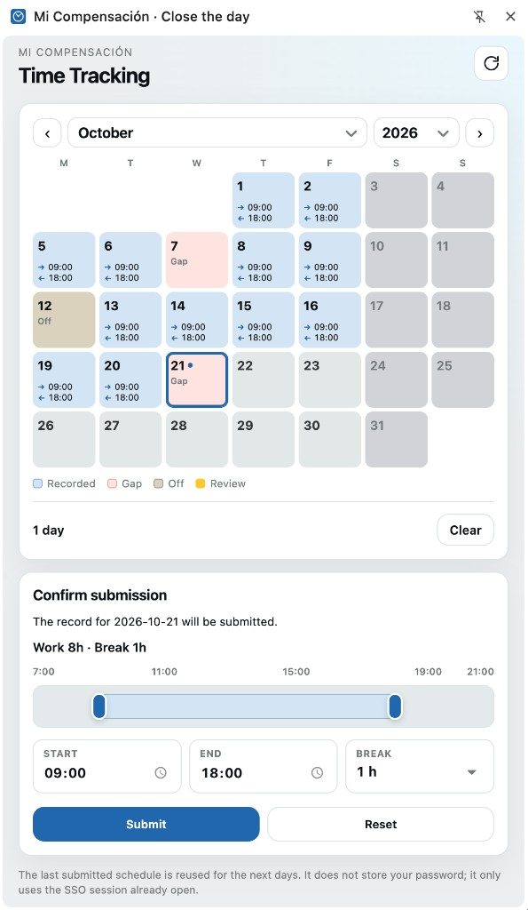

# Mi Compensación · Close the day

Unofficial Chrome extension that helps you **close and edit workdays** on
[Mi Compensación](https://micompensacion.com) using the SSO session you already
have open in the browser.

[](LICENSE)

> **Not affiliated** with Compensa, Mi Compensación, or any employer.
> This is a personal, unofficial helper. Use it only if your workplace policy
> allows automating the portal UI.

## Preview



## Features

- Side panel calendar for the selected month
- Highlights missing or incomplete days (gaps)
- Close or edit one or many days with your preferred schedule
- Remembers the last schedule you submitted as the default
- Uses the portal session already open — **does not store your password**

## Download

Get a local copy of the repo (pick one):

**Option A — ZIP (no Git required)**

1. Open the [GitHub repository](https://github.com/juansoilan/mi-compensacion-horas).
2. Click the green **Code** button → **Download ZIP**.
3. Unzip it somewhere permanent (for example `~/Extensions/mi-compensacion-horas`).
4. The folder you load must contain `manifest.json` at the root.

**Option B — Git clone**

```bash
git clone https://github.com/juansoilan/mi-compensacion-horas.git
cd mi-compensacion-horas
```

Keep the folder; Chrome/Edge load the extension from that path. If you move or
delete it, the browser will disable the extension until you load it again.

## Install on Google Chrome

1. Open `chrome://extensions` in the address bar.
2. Turn on **Developer mode** (top-right toggle).
3. Click **Load unpacked**.
4. Select the **repository root** (the folder that contains `manifest.json`).
5. Confirm the extension appears in the list and is enabled.
6. Optionally pin it from the puzzle-piece menu for quick access to the side
   panel.

## Install on Microsoft Edge

Edge is Chromium-based, so the same unpacked flow works **if** your machine
allows developer / sideloaded extensions.

1. Open `edge://extensions` in the address bar.
2. Turn on **Developer mode** (left sidebar / bottom toggle, depending on Edge
   version).
3. Click **Load unpacked**.
4. Select the **repository root** (the folder that contains `manifest.json`).
5. Confirm the extension appears and is enabled.

### Edge managed by your company (common blocker)

Many corporate Edge installs are **managed by MDM / Intune / Group Policy**. In
that case you may see errors such as:

- Developer mode is locked or turns itself off
- **Load unpacked** is missing or greyed out
- “This extension is not from any known source” / not signed / blocked by
  organization policy
- The extension installs briefly and then disappears after a policy refresh

This project is an **unpacked, unsigned** developer build. It is **not**
published to the Edge Add-ons store and is **not** enterprise-signed. If your
company policy only allows store or allowlisted extensions, **you will not be
able to add it on that managed Edge profile**.

What you can try (only if your IT policy allows it):

- Use a **personal / non-managed** Edge or Chrome profile on the same machine
- Use **Google Chrome** (if it is not under the same extension policy)
- Ask IT whether unpacked / developer extensions are permitted, or whether the
  extension can be allowlisted

Do **not** try to bypass corporate security controls. If policy blocks it, use
Chrome on a device/profile where you are allowed to load unpacked extensions,
or do not install it.

## Usage

1. Sign in to [micompensacion.com](https://micompensacion.com) in a normal tab
   (complete SSO as usual).
2. Open the extension side panel.
3. Refresh the month view.
4. Select the day(s) you want to close or edit.
5. Confirm the schedule (entry / exit / pause) and submit.

The extension talks to the portal from your browser using your existing session
cookies. The last successful schedule becomes the default for the next run.

## Permissions

| Permission | Why it is needed |
| --- | --- |
| `storage` | Save your preferred schedule and UI preferences locally |
| `sidePanel` | Show the calendar UI in Chrome’s side panel |
| `tabs` | Find an open Mi Compensación tab with an active session |
| `scripting` | Inject the content script that reads/writes portal pages |
| `webNavigation` | Detect portal navigation so the panel stays in sync |
| Host access to `https://*.micompensacion.com/*` | Call the portal APIs from pages on that domain only |

## Verify (offline)

No npm install is required. With [Node.js](https://nodejs.org/) 18+:

```bash
node fixtures/verify.mjs
node fixtures/verify-finalizar.mjs
node fixtures/verify-batch-edit.mjs
node fixtures/verify-mis-registros.mjs
```

These scripts exercise parsing and payload helpers against local HTML fixtures.
They do not call the live portal.

## Privacy

- Credentials and passwords are **not** collected or stored by the extension.
- Requests use `credentials: 'include'` so the browser attaches the cookies from
  your already-authenticated portal tab.
- Settings (for example schedule defaults) are stored in
  `chrome.storage.local` on your machine.
- The extension does not send data to third-party analytics or backends.

## Disclaimer

- Use at your own risk.
- Respect your employer’s policies and the portal’s terms of use.
- Portal HTML and endpoints can change without notice; the extension may break
  or behave incorrectly after a portal update.
- Submitting incorrect times can affect HR records. Double-check before
  confirming batch updates.

## License

MIT — see [LICENSE](LICENSE).
